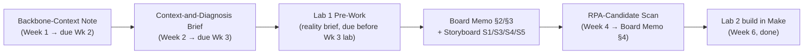

# IE-GY 9113B — Systems Integration: From ERP to Agentic AI

Vault home / map of content. Capstone company: **Sweetgreen** (Order-to-Cash process).

## Course-wide references

Raw, professor-provided reference material — see `raw/data/pdf/` and `raw/data/markdown/` in [[ROBOT]] for the layer this belongs to. Each linked Markdown note has a matching original PDF at the same topic folder + basename under `raw/data/pdf/`, kept for anything the Markdown conversion couldn't carry over.

- [[IE-GY_9113B_Systems_Integration_Syllabus_Master_Brightspace|Syllabus]]
- [[IE-GY_9113B_Assessment_Rubrics_v1|Assessment Rubrics]]
- [[IE-GY_9113B_Capstone_Kit_Orientation_v1|Capstone Kit Orientation]]
- [[IEGY_9113B_Capstone_Storyboard_v2|Capstone Storyboard]]
- `raw/data/pdf/final-project-info/Final Project Teams.pdf` — team assignments; kept as a raw PDF only, not converted or excerpted, since it names other students
- [[announcements|Course announcements]]

## Weekly course materials

Also raw — Markdown at `raw/data/markdown/course-weeks/`, each converted from the matching Brightspace PDF at `raw/data/pdf/course-weeks/` (same topic folder, same basename).

| Week | Study note | Slides / other | Wiki summary |
|---|---|---|---|
| Week 0 (optional) | [[W0_ERPFloor_Course Primer\|The ERP Floor — pre-course primer]] | — | [[Week-0-ERP-Floor]] |
| Week 1 — The Integration Backbone | [[W01_IntegrationBackbone_StudyNote_PB14\|study note]] | [[W1_IntegrationBackbone_Slides_v3\|slides]] | [[Week-1-Integration-Backbone]] |
| Week 2 — Failure to Leverage | [[W02_FailureToLeverage_StudyNote_v6\|study note]] | [[W2_FailureToLeverage_Lecure Notes_v9\|lecture notes]] | [[Week-2-Failure-to-Leverage]] |
| Week 3 — Lab 1: Diagnose & Map a Process | [[IE-GY-9113B_Lab1_StudyNote\|study note]] | [[W3_Lab1_Lecture-Notes\|lecture notes]] | [[Week-3-Lab-1-Diagnose-and-Map]] |
| Week 4 — RPA: The Tactical Integration Layer | [[W04_RPA_StudyNote\|study note]] | [[W04_RPA_LN_Slides_v1\|lecture slides]] | [[Week-4-RPA]] |
| Week 5 — Scaling RPA: Center of Excellence | [[W05_ScalingRPA_CoE_StudyNote_v2\|study note]] | [[W05_ScalingRPA_CoE_LN_Slides_v1\|lecture slides]] | [[Week-5-Scaling-RPA-and-CoE]] |
| Week 6 — Lab 2: Automate the Repeatable Part | [[W06_Lab2_Automate_StudyNote_v1\|study note]] | [[W06_Lab2_Automate_LN_Slides_v1\|lecture slides]] | [[Week-6-Lab-2-Automate]] |
| Week 7 — From RPA to Intelligent Automation | [[W07_RPAtoIA_StudyNote_v1\|study note]] | [[W07_RPAtoIA_LN_Slides_v1\|lecture slides]] | [[Week-7-RPA-to-Intelligent-Automation]] |
| Week 8 — AI Agent Architecture: SPAR | [[W08_SPAR_StudyNote_v1\|study note]] | [[W08_SPAR_LN_Slides\|lecture slides]] | [[Week-8-SPAR-Agent-Architecture]] |
| Week 9 — Lab 3: Build the Agent, Then Govern It | [[W09_Lab3_Agent_StudyNote_pre-Lab\|study note]] | [[W09_Lab3_Agent_LN_Slides_v1\|lecture slides]] | [[Week-9-Lab-3-Governed-Agent]] |

## Sweetgreen capstone deliverables

All Sweetgreen deliverables live in `wiki/project/` (the LLM-maintained layer), separate from the raw week-by-week course materials. They build on each other in order:

| Deliverable | Due | Note |
|---|---|---|
| Backbone-context note | Week 2 | [[Backbone-Context-Note-Sweetgreen]] |
| Context-and-diagnosis brief | Week 3 | [[Context-and-Diagnosis-Brief-Sweetgreen]] |
| Lab 1 pre-work (reality brief) | Before Week 3 lab | [[Lab1-Prework-Sweetgreen]] |
| Lab 1 process map, curveball, and data sandbox | Week 3 lab, sharpened Week 4 post-checkpoint | [[Lab1-Process-Map-Sweetgreen]] |
| RPA-candidate scan (Board Memo §4) | Week 4 | [[RPA-Candidate-Scan-Sweetgreen]] |
| Lab 2 automation build and tests (Board Memo §4) | Week 6 | [[Lab2-Automation-Sweetgreen]] |
| Week 8 breakout: SPAR sketch for the D3 agent (Board Memo §5, slide S8) | Week 8 | [[SPAR-Sketch-Sweetgreen]] |
| Week 8 full SPAR draft with Board Memo §5 seed | Week 8 | [[SPAR-Sketch-Sweetgreen-Full]] |
| Lab 2 D2 scenario with AI suggestion and kill switch (Make, v5 export) | Week 8 | [[Lab2-D2-Scenario-Diagram]], `wiki/project/week8/Lab2-D2-Availability-Check.blueprint.v5.json` |
| Lab 3 governed recovery agent, customer in the loop (Make v6 blueprints, untested) | Week 9 | [[Lab3-Governed-Recovery-Agent]], `wiki/project/week9/` |
| Lab 3 team handoff (workstreams, shared contract) and sheet setup prompts | Week 9 | [[Lab3-Team-Handoff]], [[Lab3-Sheet-Setup-Prompts]], [[Lab3-Final-Flow]] |
| Midterm quiz answers (Quiz 1, due Oct 14) | Midterm | [[Midterm-Quiz-Answers]] |
| Order-to-payment process map (swimlane diagram) | Week 3 | [[Order-and-Payment-Process-Map]] |
| Discussion Forum 1: post and replies (Brightspace, due Oct 3) | Module 1 | [[Discussion-Forum-1-Post]], [[Discussion-Forum-1-Replies]] |
| Discussion Forum 2: post on the RPA safe-automation line (due Oct 28, replies Oct 31) | Module 2 | [[Discussion-Forum-2-Post]] |
| Board presentation deck (living, filled in lab by lab) | Ongoing | `wiki/project/shared/Board-Presentation-Sweetgreen.pptx` |
| Lab 1 presentation (standalone, to present in class) | Week 3 lab | `wiki/project/week3/Lab1-Presentation-Sweetgreen.pptx` |
| Week 4 presentation (standalone, to send teammates) | Week 4 | `wiki/project/week4/Week4-Presentation-Sweetgreen.pptx` / `.pdf` |
| Public research log | Ongoing | [[Sweetgreen-Public-Research]] |

Team Drive transcriptions of the Lab 2 files (text only) are under `raw/data/markdown/team-drive/lab2/`. Raw material feeding these: [[Sweetgreen-Breakout-Provenance]] (in-class breakout history, `wiki/project/shared/`) and [[Sweetgreen-Lab1-Sandbox.xlsx|the Gemini-generated Lab 1 sandbox]] (`raw/data/datasets/`). The team's graded final annotated map (PDF) was read once, its content fully folded into [[Lab1-Process-Map-Sweetgreen]] (control register, friction chain, diagnosis), then removed — nothing in it wasn't already captured there.

## Concepts, entities, and comparisons

The vault's running glossary and cross-reference layer — kept current instead of re-defined inline every time something is used. All under `wiki/`; see "The vault as an LLM wiki" in [[ROBOT]] for how this layer is maintained.

**Concepts** (`wiki/concepts/`): [[Center of Excellence]] · [[Control Point]] · [[Decision Point]] · [[Leverage Gap]] · [[Obliterate Then Automate]] · [[RPA Candidate Criteria]] · [[Four Lenses]] · [[Three Threads]] · [[Four Archetypes]]

**Entities** (`wiki/entities/`): [[Sweetgreen]] · [[Thermo Fisher Scientific]] · [[Bailey Hydraulics]]

**Comparisons** (`wiki/comparisons/`): [[RPA vs Traditional Automation vs AI]]

## Open-task checklist (from the announcements)

- [x] Convert all course PDFs to Markdown, keeping both (paired by basename under `raw/data/pdf/` and `raw/data/markdown/`)
- [x] Draft Week 1 backbone-context note (Sweetgreen)
- [x] Draft Week 2 context-and-diagnosis brief (Sweetgreen)
- [x] Draft Lab 1 pre-work / reality brief (Sweetgreen)
- [x] Sharpen Lab 1 deliverable post-checkpoint (specific control-point register, one-page diagnosis) and share the updated version with the professor before the Sep 25 class
- [x] Draft the Week 4 RPA-candidate scan (Board Memo §4), completing all three in-class breakouts (map tagged end to end, the filtered scan, one candidate costed and governed)
- [x] Send Week 1 + Week 2 notes to the professor by email before the Sep 18 lab (`ec5743@nyu.edu`)
- [x] Set up/confirm free accounts: Miro or Lucidchart, Airtable or Google Sheets + Gemini
- [x] Make account, before Lab 2 (Week 6)
- [x] Team stack path declared by end of Week 3

## Vault conventions

See `ROBOT.md` at the repo root for how notes are structured, tagged, and maintained.
