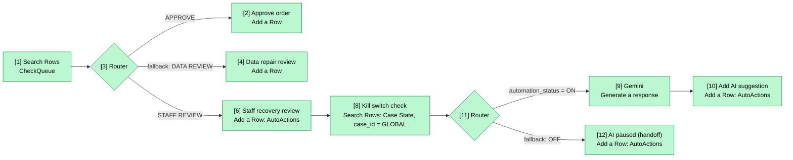

# Lab 2 D2 Availability Check: Scenario with AI Suggestion and Kill Switch

Status at end of 2026-10-28: built and tested end to end in Make, scenario left inactive. The importable export is `Lab2-D2-Availability-Check.blueprint.v5.json` in this folder. One email in the export was redacted. After importing, pick the Google and Gemini connections again in each module.

## Flow

All modules are green (built and run). Modules 8 to 12 were added this session on the STAFF REVIEW route. Modules 1 to 6 are unchanged from [[Lab2-Automation-Sweetgreen]].

## Modules added

| # | Module | What it does |
|---|--------|--------------|
| 8 | Google Sheets Search Rows | Reads the `GLOBAL` row of `Case State`. Limit 1. |
| 11 | Router | ON route goes to Gemini. Fallback route (anything but ON, including a missing row) writes the pause row. |
| 9 | Gemini (`gemini-3.5-flash-lite`) | Picks SWAP, PARTIAL_CHANGE, CANCEL or HOLD. Replies in one line: `PICK \| reason naming the rejected option \| confidence \| draft message`. |
| 10 | Google Sheets Add a Row | Writes a row with `decision` = AI_SUGGESTION. Splits the Gemini reply into columns L to O. |
| 12 | Google Sheets Add a Row | Writes a row with `decision` = AI_PAUSED when the kill switch is OFF. |

Gemini only recommends. The draft customer message is never sent, and the agent has no write access to the order system.

## Prompt rules in v5 (module 9)

- HOLD only when availability is blank, source age is over 60 minutes, status is BLOCKED, prior exception is 1, or matched lines differ from lines.
- Availability 0 is the normal stockout and is not a HOLD reason. (v4 missed this and returned HOLD for B1 too, citing availability 0.)
- Plain stockout: SWAP for a one-line order, PARTIAL_CHANGE for a multi-line order, CANCEL only if neither works. Name the rejected option.
- No diet or allergy claims, because the data has no such column.
- Confidence capped at 70 for SWAP, PARTIAL_CHANGE and CANCEL, and at 90 for HOLD, because urgency, prep time and queue data are not in the row.

## Sheet setup (Sweetgreen Lab 2 Sandbox)

| Tab | Change |
|-----|--------|
| `Case State` | New row 2 with `case_id` = GLOBAL. `B2` = `=COUNTIFS('Staff Feedback'!D:D,"REJECT",'Staff Feedback'!F:F,">="&(NOW()-G2/24))`. `C2` = `=IF(B2>=H2,"OFF","ON")`. `G2` = 24 (window hours), `H2` = 3 (max rejects). Headers `window_hours` and `max_rejects` in G1 and H1. |
| `Staff Feedback` | New column F `decided_at`. Column D already has a dropdown of ACCEPT or REJECT only, so the formula counts `REJECT`. |
| `AutoActions` | New column O `ai_draft_message`. Columns L to N (`ai_recommendation`, `ai_reason`, `ai_confidence`) already existed. |
| `AI Suggestions` (new) | `=QUERY(AutoActions!A:O,"select B,C,L,M,N,O,K where F='AI_SUGGESTION' order by K desc",1)`. Shows only the AI suggestions, newest first. |

The shift lead records the verdict in `Staff Feedback` (ACCEPT or REJECT, plus the time in `decided_at`). Nothing else feeds the count.

## Tests run on 2026-10-28

| Test | Result |
|------|--------|
| Kill switch ON, run once | Gemini and module 10 ran for both STAFF REVIEW cases. Rows written with columns L to O filled. |
| Kill switch OFF by setting `H2` = 0 | Gemini got 0 operations. Two AI_PAUSED rows written. |
| 3 REJECT rows with a current `decided_at` | `B2` = 3, `C2` = OFF, same pause behavior as above. Test rows removed afterwards, `B2` back to 0. |
| v3 prompt | Both cases HOLD, confidence 100, and an invented diet concern for B1. |
| v4 prompt | Both cases HOLD, confidence 90, B1 wrongly blamed on availability 0. |
| v5 prompt | B1 SWAP (confidence 70), B2 HOLD (confidence 90, BLOCKED plus prior exception). |

Two bugs found by testing: the original count formula looked for `REJECTED` but the dropdown only allows `REJECT`, so the kill switch could never trip. And the v3 and v4 prompts treated availability 0 as a HOLD reason. Both are fixed.

## Differences from the SPAR sketch

[[SPAR-Sketch-Sweetgreen]] proposes a breaker after 3 overrides in a row. This build trips after 3 REJECT decisions inside a rolling 24-hour window, counted across all cases, and it re-enables itself when the rejections age out of the window. If a human-only restart is wanted, add a manual flag. The per-store breaker and the slow drift signal (override rate on hard cases) are not built.

## Open items

- Test rows from the 2026-10-28 runs are still in `AutoActions` (82 rows dated that day, including 6 AI_SUGGESTION and 6 AI_PAUSED). Decision pending: keep as history, relabel the final run, or delete.
- Two checks so far (B1 and B2). Not enough to judge drift toward one answer.
- Confidence caps come from the prompt, not from calibration.
- Duplicate prevention is still future work: every run re-reads `CheckQueue` and appends again.
- `Case State` still holds older per-case rows with status `AI_ACTIVE`. Only the `GLOBAL` row is used.
- Scenario is inactive. Do not switch on the 15-minute schedule before the test rows are dealt with.
