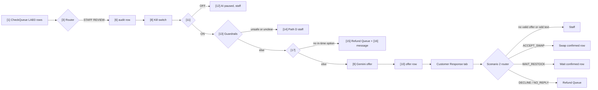

# Lab 3 Governed Recovery Agent: Customer in the Loop

Status 2026-10-30: three Make blueprints (v7, see the v7 section at the end), generated from the v5 export. The v6 drafts were deleted. The v7 scenario 1 imported into Make without errors; nothing has been run yet. The Google connection label is redacted. After import, pick the Google and Gemini connections again in each module.

## Why change the design

In [[Lab2-D2-Scenario-Diagram]] every stockout waits for the shift lead, so staff are the bottleneck. Most stockouts have a safe in-stock replacement. The customer can choose on their own, and staff time goes to the cases that need judgment (allergens, conflicting stock, odd text). Responsibility is shared: code checks, the model words the offer, the customer chooses, staff handle risk, finance approves money.

## Four paths

| Path | Condition (checked in code, before the model) | What happens |
|---|---|---|
| A. Offer | Clean row, stock replacement, more than 60 min to deadline | Gemini picks swap or swap-or-wait and drafts the message. Offer valid 60 min. |
| B. Time-tight | Clean row, in stock replacement, 60 min or less | Swap only, offer valid 10 min. |
| C. Fast refund | Replacement not available and restock is unknown or later than the deadline | Code queues the refund request in `Refund Queue` first. Gemini then words the apology (stock and time, no guarantee). A fixed template is the fallback if Gemini returns nothing. |
| D. Staff | Allergen blank or not NONE, replacement unknown, instruction-like text in `customer_note`, fresh contradictory stock (cached 1, current 0, age 10 min or less), source older than 60 min, deadline missing or past, BLOCKED, prior exception, line mismatch | Code writes the staff row first. Gemini then adds an advisory brief (suggested action, main risk, draft message) so the lead decides faster. It never sees the customer note and never clears an allergen. |

Kill switch OFF sends every case to staff (existing behavior, now path D). Gemini does the wording or recommendation on paths A, B, C and D (temperature 0.1), but code decides the path and queues the refund and staff rows before any model call, so a bad model answer cannot change what happens. The customer note is never put in a prompt.

## Boundary change vs the Week 8 sketch

[[SPAR-Sketch-Sweetgreen]] said the agent must not touch customer messages, refunds or allergy decisions. New line:

- **Messages:** Gemini drafts for every path, and nothing is sent by the agent. Path C falls back to a fixed template. Nothing is applied until the customer replies, and the reply must match an unexpired offer that was actually made.
- **Refunds:** the agent only queues a `PENDING_FINANCE` row. It never moves money.
- **Swaps:** a confirmed swap is a row for the kitchen. The agent still has no write access to the order system.
- **Allergies:** human only. Unknown or flagged goes to staff before the model runs.

## Sheet changes (what the clipboard prompt asked for)

`CheckQueue` gets Q `needed_by`, R `allergen_flags`, S `substitute_item_id`, T `substitute_available`, U `restock_eta_min`, V `customer_note`, W `mins_to_deadline`. New tabs `Customer Response` (case_id, order_id, offered_options, customer_choice, responded_at, customer_free_text, processed) and `Refund Queue` (case_id, order_id, reason, requested_at, status, approved_by). `AutoActions` gets P `path`, Q `offered_options`, R `offer_expires_at`, S `customer_message`, T `final_outcome`. `Case State` gets J2 customer decline rate (24 h), the Reflect signal. Nine `LAB3` test rows.

## Expected result per test row

| Case | Expected | Break it covers |
|---|---|---|
| L3_A | Path A offer, `CUSTOMER_OFFER` | Happy path |
| L3_B | Path B, swap only, 10 min expiry | Time pressure |
| L3_C1 | Path C, refund queued | No replacement, no ETA |
| L3_C2 | Path C, refund queued | Restock too late |
| L3_D1 | Path D | Missing allergen field |
| L3_D2 | Path D | Allergen flag |
| L3_X1 | Path D | Break 1, contradictory signals |
| L3_X2 | Path D | Break 2, impossible deadline |
| L3_X3 | Path D | Break 3, embedded instruction |

Guardrail per break: validation before reasoning (breaks 2 and 3), human on contested calls (break 1), kill switch and refund queue bound the damage.

## Reflect

Drift signal: customer decline rate in the last 24 h (`Case State!J2`) next to the staff reversal rate on path D. A rising decline rate means the offers are poor. Check daily, same owner as the kill switch (shift lead per case, ops manager per store).

## Not verified, check after import

- Router filter operators `notexist`, `text:pattern:ci`, `text:notpattern`, `date:greater` were written from memory of Make's blueprint format. If a filter shows blank in the UI, re-pick the operator.
- Gemini `temperature` inside `generationConfig` and the `updateRow` `rowNumber` mapping are unconfirmed.
- Scenario 2: a customer reply with no matching offer returns zero bundles from the search module, so the run stops and the reply stays `processed = NO`. Staff should scan for those. A proper fix needs an aggregator.
- Path D also gets the older `STAFF_REVIEW` audit row from module 6, so a staff case has two rows.
- The customer message is written to the sheet, not sent. A Gmail module is the next step.
- Paths C and D now have two Gemini calls in the chain. If one errors, the refund row or staff row is already written, but the message or brief row is missing. Check Incomplete executions.
- Next automation step: a `Menu` tab (item_id, category, available) so Gemini proposes the replacement from in-stock items of the same category instead of reading `substitute_item_id`. Code would verify the pick exists and is in stock before it is offered.
- Run one case at a time (credits). Filter in module 1 is `LAB3` only, limit 12.

## Where to cut human input, and where a person stays

Read against [[Lab3-Final-Flow]]. Proposals, not built.

| Step today | Human today | Proposal | Person stays? |
|---|---|---|---|
| Stock check at order time | None, but it happens after the order exists | **Shift left:** check stock at checkout. If an item is out, show in-stock same-category replacements before the order is placed, so no recovery case is created | No |
| Data repair review (stale or unmatched row) | Staff | Re-read stock automatically once, then recheck. Only staff if still stale | Only if the second read fails |
| Duplicate STAFF_REVIEW audit row (module 6) plus path D row | Staff read both | Drop module 6 and keep one row per case | No |
| Replacement choice | Staff or a column filled by hand | Gemini picks from a `Menu` tab, code checks it exists and is in stock | No |
| Offer, confirmation and apology messages | Staff draft | Gemini words them, a fixed template sends them | No |
| Stock re-check before swap, restock check, offer timeout | Staff chase | Scheduled scenario, auto swap or auto refund request | No |
| Refund approval | Finance, every case | Auto-approve small amounts under a set cap on path C, human above the cap or on repeat refunds for one customer | Above the cap |
| Allergen flagged or unknown | Staff | Stays. Code never clears it, Gemini never claims safety | **Yes, always** |
| Injected text, contradictory fresh signals, blocked order | Staff | Stays, Gemini brief makes it faster | **Yes** |
| Kill switch pull and restart | Shift lead and ops manager | Stays. Auto-trip on rejects is fine, restart needs a person | **Yes** |
| Policy and thresholds (60 min, caps, decline-rate limit) | Ops manager | Weekly review of the Reflect numbers | **Yes** |

**Reflect loop for customer satisfaction.** Add one optional field to `Customer Response`: `reason` (dropdown: price, taste, time, allergy worry, other) and a 1 to 5 rating after pickup. Weekly, Gemini summarises the declines and low ratings into proposed prompt or rule changes (for example "customers decline swaps over $2 dearer"). A person approves the change before it goes live, so the loop improves offers without the model rewriting its own rules.

**Rule for what stays human.** A person decides when the cost of a wrong call is health (allergens), money above the cap, a manipulated input, or a change to the rules themselves. Everything else is repeatable and goes to code plus Gemini.

## v7 build (2026-10-30, built before the 20-minute presentation, not yet run)

Three blueprints in `wiki/project/week9/`: `Lab3-D2-Recovery-Agent.blueprint.v7.json`, `Lab3-Customer-Reply-Handler.blueprint.v7.json`, `Lab3-Follow-up-Sweeper.blueprint.v7.json`. Supersede v6.

- **Gemini picks the replacement, code verifies it.** The sheet builds `candidate_list` (same category, in stock, allergen NONE) from the `Menu` tab. Gemini may only pick from that list. Make then checks the pick text is inside the list. A pick outside it, or an empty one, goes to staff with a "guard caught the model" row.
- **Live stock re-check before a swap.** `Customer Response!I` looks the item up in `Menu` at the moment the reply is processed. If it is gone, the reply goes to staff instead of confirming the swap.
- **Follow-up sweeper.** A third scenario reads `Follow-up Queue`: an offer that timed out with no reply becomes a queued refund, a waiting customer whose restock time has come gets either `RESTOCK_CONFIRMED` (item is back) or a queued refund (still out).
- **Refund cap.** `Case State!I2` (15). At or under the cap the request is `AUTO_APPROVED` with `approved_by = RULE_CAP`. Above it, `PENDING_FINANCE`. The cap check is a Make expression, not the model. Test rows: L3_C1 ($12) auto-approves, L3_C2 ($28) goes to finance.
- **Still human:** allergen flags, instruction-like text, contradictory or stale stock, refunds above the cap, the kill-switch restart, and rule changes.

Unverified in Make: the `text:contain` filter, `if()` inside the status field, the `Menu`-based sheet formulas, and that scenario 3 should be set to run on demand for the demo (the blueprint carries no schedule).
